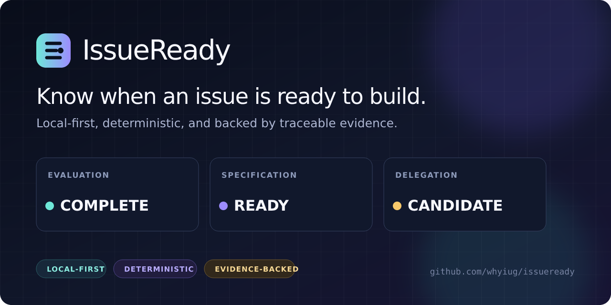
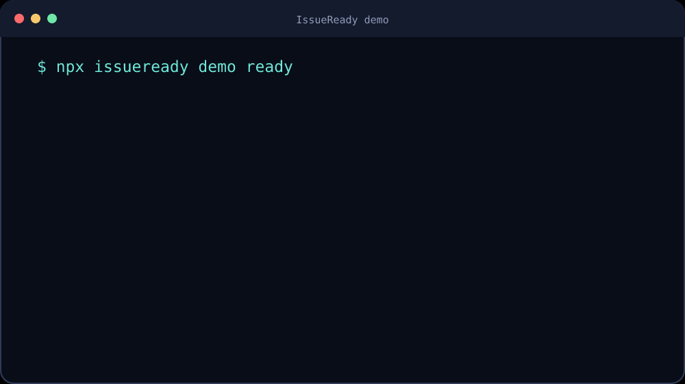

# IssueReady



[](https://github.com/whyiug/issueready/actions/workflows/ci.yml)
[](https://www.npmjs.com/package/issueready)
[](LICENSE)
[](https://nodejs.org/)

IssueReady tells you whether a GitHub issue is ready for a human or coding
agent—locally, deterministically, and with traceable evidence. It never executes
an agent or writes to GitHub.

Instead of hiding uncertainty inside one score, IssueReady keeps three decisions
separate:

- **Evaluation:** did the analysis complete reliably?
- **Specification:** is the task ready, missing information, or demonstrably too broad?
- **Delegation:** may an agent work independently, under supervision, or only with a human?

## Try it

Requirements: Node.js 22.12 or later and npm 10.9 or later.

```bash
npx issueready demo ready
npx issueready demo needs-info
```



The demonstrations are project-authored synthetic issues with reviewed semantic
signals. They show the full decision contract without sending content to a
model or network service.

## Check an issue

Evaluate a local Markdown draft:

```bash
npx issueready path/to/issue.md
```

Evaluate a public GitHub issue by URL or shorthand:

```bash
npx issueready https://github.com/owner/repository/issues/123
npx issueready owner/repository#123
```

Public issues work anonymously. For private issues or higher GitHub API rate
limits, set `GITHUB_TOKEN` in the environment. Tokens are never accepted as
command arguments, persisted, or included in reports.

The default output is a compact terminal summary:

```text
IssueReady 0.1.1
Task:          bug
Evaluation:    COMPLETE
Specification: READY
Delegation:    CANDIDATE
Blocking checks: none
```

Use `--format markdown` for an evidence report or `--format json` for
automation. Add `--include-quotes` only when redacted source excerpts are
appropriate for the output destination.

See the [CLI reference](docs/cli.md) for all commands, output behavior, exit
codes, network boundaries, and alpha limitations.

## Why IssueReady

- **Evidence over heuristics.** Findings point to exact source spans and versioned rules.
- **Deterministic by default.** Local evaluation needs no API key, model, database, or network connection.
- **Honest uncertainty.** Missing semantic coverage, permission failures, rate limits, and partial input never masquerade as missing requirements.
- **Repository-aware.** Policies, Issue Forms, task types, fields, relationships, and dependency state have explicit representations.
- **Safe integration boundary.** GitHub access is read-only and bounded; the evaluation core remains side-effect free.

## Interpreting results

Deterministic evidence can prove facts such as an empty required field, multiple
independent goals, navigation hints, references, or snapshot truncation. Criteria
that require semantic judgment remain `UNKNOWN` unless a profile-locked semantic
adapter supplies evidence. In that case IssueReady reports a degraded evaluation
instead of manufacturing a `READY` or `NEEDS_INFO` verdict.

This distinction is intentional: an incomplete analysis is not evidence that an
issue is incomplete.

For the design rationale and relationship to AI issue intake, read
[Why issue readiness is not one score](docs/why-readiness-is-not-a-score.md).

## Core API

The source workspace also exposes a small evaluation facade for adapters and
applications:

```ts
import {
  evaluateIssue,
  loadPolicy,
  normalizeIssue,
  renderReport,
} from "@issueready/core";

const snapshot = normalizeIssue(issue, { evaluatedAt });
const policy = loadPolicy(policyLayers);
const report = evaluateIssue(snapshot, policy, evaluationOptions);
const markdown = renderReport(report, "markdown", {
  localeBundle: evaluationOptions.assets.localeBundle,
});
```

The internal workspace packages are not independently published in the alpha
release. See the [core API guide](docs/concepts/core-api.md) and runnable
[source example](examples/evaluate-local-issue.mjs) for complete inputs.

## Develop from source

```bash
git clone https://github.com/whyiug/issueready.git
cd issueready
corepack enable
corepack pnpm install --frozen-lockfile
corepack pnpm validate
```

The workspace contains focused ESM packages under `packages/`, versioned JSON
Schemas under `schemas/`, rule manifests under `rules/`, synthetic fixtures,
examples, documentation, and reviewed mutation evidence. Start with the
[documentation index](docs/README.md) and [architecture](docs/architecture.md).

## Status

`v0.1.1` is an alpha release. The CLI and wire contracts are usable, but command
and schema compatibility may change before `v1.0.0`. Production automation
should pin an exact version.

## Security and privacy

IssueReady does not require local issue content to leave the process. Evidence
quotes are omitted by default, credential-shaped values are redacted, and
GitHub credentials are added only at the final request boundary.

Report vulnerabilities privately according to [SECURITY.md](SECURITY.md). Do
not include secrets, private issue content, or tests against public deployments.

## Community

- Read [CONTRIBUTING.md](CONTRIBUTING.md) before opening a pull request.
- Use [SUPPORT.md](SUPPORT.md) to choose the right support channel.
- Follow the [Code of Conduct](CODE_OF_CONDUCT.md) in all project spaces.

## License

IssueReady is available under the [MIT License](LICENSE).
